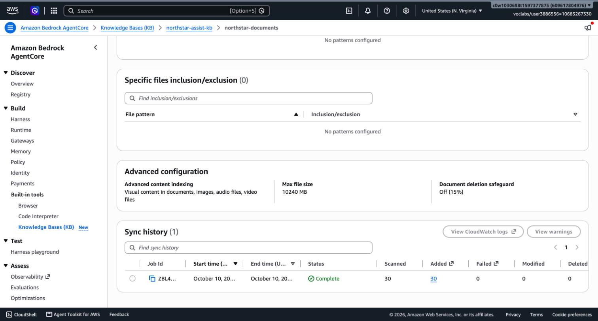
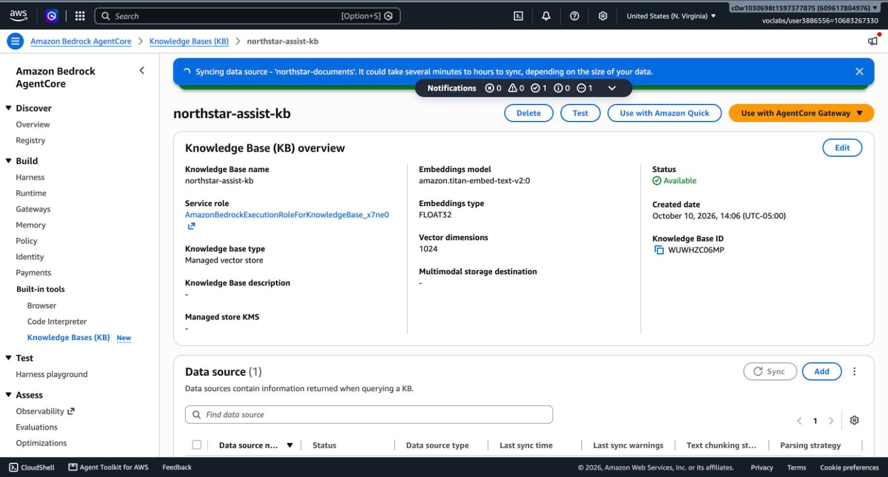
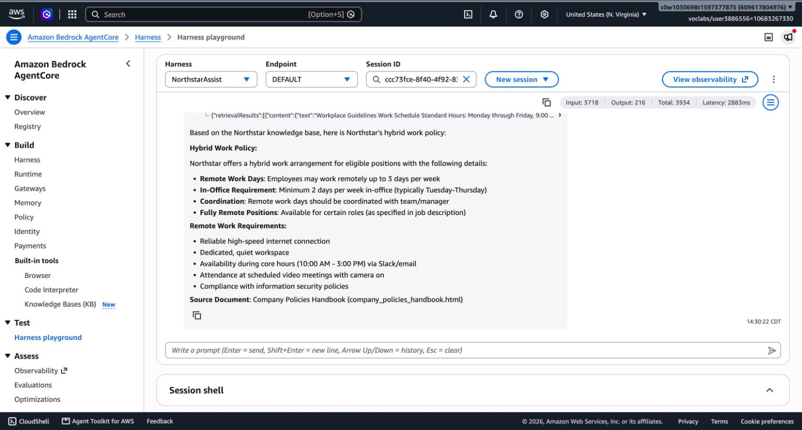
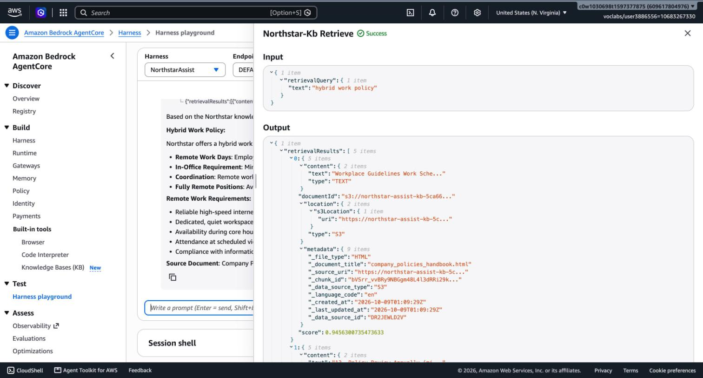

# Task 1: Working AgentCore Harness with Knowledge Base Retrieval

**System:** Northstar Assist. **Account:** Udacity Cloud Lab (…4976), us-east-1. **Date:** 2026-10-10.

## 1. What was deployed

| Resource | Name / ID | Key settings | Evidence |
|---|---|---|---|
| S3 bucket | `northstar-assist-kb-5ca661ad` | 30 documents, public access blocked, SSE-S3, versioning on | `evidence/task1/s3_*.json` |
| Managed Knowledge Base | `northstar-assist-kb` (`WUWHZC06MP`) | Type MANAGED, Titan Text Embeddings V2 (`amazon.titan-embed-text-v2:0`), 1024 dimensions, FLOAT32 | `evidence/task1/kb_details.jpg`, `knowledge_base.json` |
| Data source | `northstar-documents` (`DR2JEWLD2V`) | S3, managed parser, default chunking, on-demand sync | `evidence/task1/kb_sync.jpg` |
| AgentCore Gateway | `northstar-assist-gateway` (`northstar-assist-gateway-hd1uvsa8f3`) | MCP, inbound auth AWS_IAM | `evidence/task1/gateway.json` |
| Gateway target | `northstar-kb` (`5QFJRBLA4V`) | Connector `bedrock-knowledge-bases`, tool `Retrieve`, standard retrieval, 5 results | `evidence/task1/gateway_target_5QFJRBLA4V.json` |
| AgentCore Harness | `NorthstarAssist` (`NorthstarAssist-XSASd9gyWX`) | Claude Haiku 4.5 via US inference profile, course system prompt, memory disabled, gateway tool only | `evidence/task1/harness.json` |

Request path:

```
Employee → Harness (Claude Haiku 4.5) → Gateway tool → AgentCore Gateway → Managed KB → S3 documents
```

## 2. Knowledge base sync completed without errors

The data-source sync job `ZBL4LAMGLO` finished with status **COMPLETE**: **30 scanned, 30 indexed, 0 failed, 0 skipped**.



The same result from the API is saved in `evidence/task1/kb_ingestion_jobs.json`.



## 3. The harness answers a prompt using a foundation model

Prompt sent in the Harness playground and through the `InvokeHarness` API:

> What is Northstar's hybrid work policy? Name the source document.



Playground metrics for this turn: 3,718 input tokens, 216 output tokens, 2,883 ms.

## 4. The answer uses content retrieved from the knowledge base

The Agent trace shows the harness calling the **Northstar-Kb Retrieve** tool (status Success) before answering.



| Trace field | Value |
|---|---|
| Tool | `northstar-kb___Retrieve` |
| Input | `{"retrievalQuery": {"text": "hybrid work policy"}}` |
| Results returned | 5 chunks |
| Top result | `company_policies_handbook.html`, relevance score 0.946 |
| Sources across the 5 chunks | `html/company_policies_handbook.html`, `docx/security_policy.docx` |

### Scripted transcript (InvokeHarness API)

Produced by `tools/run_suite.py --smoke`; the full record, including every retrieved chunk, is in `evidence/task1/smoke_baseline_20261010T192934Z.json`. Verdict: **ANSWERED_WITH_RETRIEVAL**, 5 chunks.

```text
I'll search the Northstar knowledge base for information about the hybrid work policy.Based on the knowledge base search, here is Northstar's hybrid work policy:

**Hybrid Work Policy:**

Northstar offers a hybrid work arrangement for eligible positions with the following guidelines:

- **Remote Work Allowance:** Employees may work remotely up to 3 days per week
- **In-Office Requirement:** Minimum 2 days per week in-office (typically Tuesday-Thursday)
- **Coordination:** Remote work days should be coordinated with team/manager
- **Fully Remote Positions:** Available for certain roles (as specified in job description)

**Remote Work Requirements:**
When working remotely, employees must have:
- Reliable high-speed internet connection
- Dedicated, quiet workspace
- Availability during core hours (10:00 AM - 3:00 PM) via Slack/email
- Attendance at scheduled video meetings with camera on
- Compliance with information security policies

**Source Document:** Company Policies Handbook (company_policies_handbook.html)
```

The answer's facts (up to 3 remote days, minimum 2 in-office days, core hours 10:00–15:00) all appear in the first retrieved chunk, and the answer names the source document. This is the retrieved content in the model's context window, not model memory.

## 5. Notes for the later tasks

- **Console issue.** The console's Create Harness form created the default execution role and its policies, then stayed on "being provisioned" without creating the harness. The harness was then created with `aws bedrock-agentcore-control create-harness`, using that console-created role and the same settings. The role and its policies are therefore the unmodified console defaults that Task 4 reviews (`iam/before/`).
- **Baseline IAM is broad.** The default harness role allows model invocation on `foundation-model/*` and on every Bedrock resource in the account, plus Browser, Code Interpreter, EFS, S3 Files and Memory statements that this harness does not use.
- **Invocation-time overrides.** The playground and the `InvokeHarness` API accept a per-request model, system prompt and tool list. Whether a caller can use this to bypass the guardrail was tested and closed in Task 4 (`deliverables/04_iam_hardening.md`).
- **Chunks reach the model unfiltered.** Each retrieved chunk carries document text and metadata straight into the model's context. No guardrail is attached at this stage.
- **Runtime log group exists:** `/aws/bedrock-agentcore/runtimes/harness_NorthstarAssist-92Prr07JAK-DEFAULT`.
