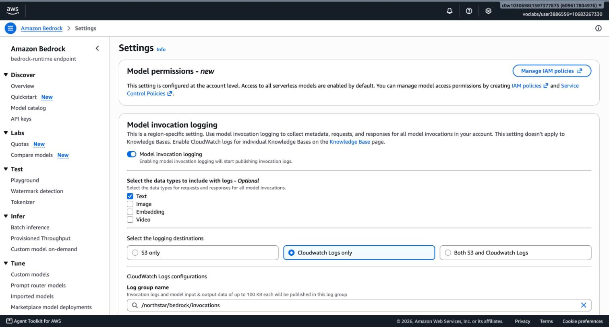
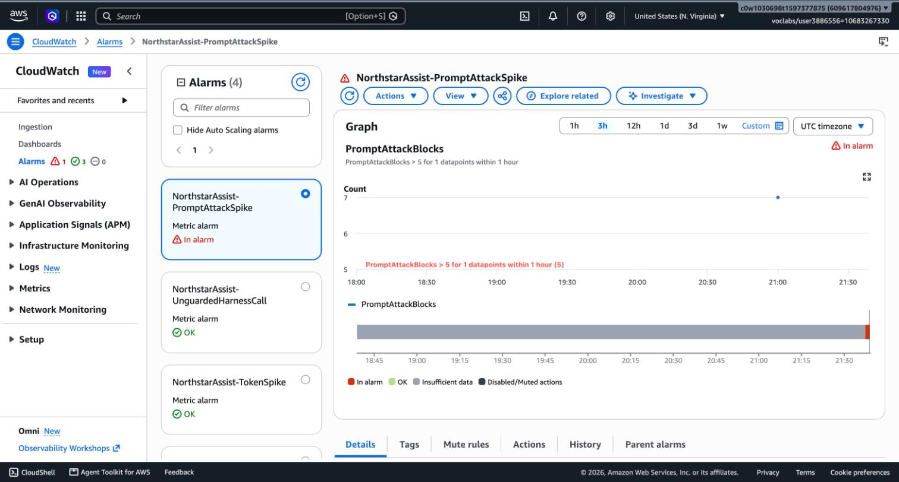

# Task 6: Monitoring Plan and Incident Response Playbook

**System:** Northstar Assist. **Date:** 2026-10-10. **Region:** us-east-1. **Log group:** `/northstar/bedrock/invocations`. **Metric namespace:** `Northstar/Assist`.

## 1. Summary

Northstar Assist is watched through Bedrock model-invocation logs. Eleven metric filters turn those logs into AI-specific metrics, four CloudWatch alarms watch the metrics, and seven saved Logs Insights queries support an investigation. Section 7 is the playbook for a suspected prompt injection.

| What | Deployed | Proof |
|---|---|---|
| Model-invocation logging (text only, 7-day retention) | Yes | `evidence/task6/invocation_logging_config.json`, `invocation_logging_on.jpg` |
| 11 metric filters | Yes, each tested against real records | `evidence/task6/metric_filters.json`, `metric_filter_tests.json` |
| 4 alarms | Yes; one driven into ALARM by replayed attacks | `evidence/task6/alarms.json`, `alarm_state.jpg` |
| 7 saved queries | Yes | `monitoring/saved_queries.json` |
| Containment script | Yes; both levels exercised on the live harness and reversed (section 7.9) | `infra/ir_contain.sh`, `evidence/task6/ir_drill.jsonl` |

Everything is created by `infra/05_monitoring.sh` from the JSON files in `monitoring/`, so it can be rebuilt and reviewed.

## 2. Log sources

| Source | Where | What it holds | Used for |
|---|---|---|---|
| **Model-invocation logs** | CloudWatch log group `/northstar/bedrock/invocations`, stream `aws/bedrock/modelinvocations` | One record per model call: caller role and session name, full prompt and response, token counts, stop reason, and the guardrail trace (which policy acted, and how many characters it screened) | Every metric and alarm below; the main investigation source |
| **Knowledge base application logs** | `/aws/vendedlogs/bedrock/knowledge-base/APPLICATION_LOGS/WUWHZC06MP` | One record per document per sync, with `crawl_action` (`ADD`, `UNMODIFIED`, ...) and status | Finding a document that was added or changed before an incident |
| **Harness runtime logs** | `/aws/bedrock-agentcore/runtimes/harness_NorthstarAssist-92Prr07JAK-DEFAULT` | Container start-up lines only (`evidence/task6/runtime_log_sample.json`) | Availability. They hold no tool-call or retrieval detail, so retrieval signals come from invocation logs instead |
| **Knowledge base embedding calls** | Same invocation log group, caller `AmazonBedrockExecutionRoleForKnowledgeBase_x7ne0`, operation `InvokeModel` | One record each time the knowledge base embeds a query | Counting retrievals independently of what the model reports |
| **S3 object versions** | Bucket `northstar-assist-kb-5ca661ad` (versioning enabled) | Every version of every document | Proving what a document said at a given time, and restoring it |
| **CloudTrail** | Not available in the Cloud Lab (`cloudtrail:LookupEvents` is denied) | Who changed the harness, guardrail, IAM policies or bucket | **Production only.** Needed to attribute configuration changes and uploads |



**Why invocation logs carry the plan.** The harness runs the agent loop inside AWS, so the application never sees which tool ran. The invocation log does: a model call that ends with `stopReason: tool_use` is a retrieval request, and the next call in the same session carries the retrieved text as a `toolResult`.

## 3. AI-specific signals

Each signal is a metric filter on the invocation log group. `default 0` means the metric reports zero when nothing matches, so alarms and ratios work during quiet hours.

| Metric | Matches | Why it matters | Threat |
|---|---|---|---|
| `GuardrailInterventions` | Harness call with `stopReason = guardrail_intervened` | Total blocks and maskings; the baseline for "is something unusual happening" | E-01, I-01 |
| `PromptAttackBlocks` | Guardrail trace contains `"type":"PROMPT_ATTACK"` with `"action":"BLOCKED"` | Someone is trying to override the assistant's instructions | E-01, S-03 |
| `DeniedTopicBlocks` | Trace contains `"type":"DENY"` with `"action":"BLOCKED"` | Requests for other employees' data, off-scope tasks, regulated advice | I-01, T-02 |
| `SensitiveInfoActions` | Trace contains `sensitiveInformationPolicy` | A PII entity or the API-key pattern was blocked or masked | I-01 |
| `HarnessAnswers` | `stopReason = end_turn`, or `guardrail_intervened` where the trace shows a value `ANONYMIZED` and nothing `BLOCKED` (a masked answer) | Answers actually delivered. The denominator for ratios | — |
| `HarnessToolCalls` | `stopReason = tool_use` | The model asked for the knowledge base | E-02, D-02 |
| `KbRetrievals` | Knowledge base role calling `InvokeModel` | A retrieval really ran | D-02, D-03 |
| `OutputTokens`, `InputTokens` | Token counts per model call | Bulk disclosure, runaway answers, cost | I-01, D-01 |
| `UnguardedHarnessCalls` | Any completed model call by the harness role with **no** guardrail assessment in its trace (errored calls excluded) | The guardrail was skipped. IAM should make this impossible | E-05, T-04 |

**One vocabulary point.** `guardrail_intervened` covers two different outcomes. A **block** replaces the whole turn with the blocked message. A **masked answer** is delivered with a value replaced, for example `{NorthstarApiKey}`. The metrics, the alarm and `tools/metrics.py` all count a masked answer as an answer. They tell the two apart by the action in the guardrail trace (`BLOCKED` or `ANONYMIZED`), not by token count: when the guardrail blocks an **answer**, the model has already written its tokens.

## 4. Alerts

| Alarm | Fires when | Why this threshold | First action |
|---|---|---|---|
| `NorthstarAssist-PromptAttackSpike` | **More than 5** prompt-attack blocks in **1 hour** | None of the 9 benign probes in Task 5 triggered the filter, so one or two blocks an hour is an employee pasting odd text. More than 5 is someone iterating on an attack | Query "prompt-attack blocks by session": one session or many? Then section 7 |
| `NorthstarAssist-ZeroRetrievalRatio` | **More than 20%** of answers in 1 hour had no Retrieve call, with at least 10 answers | Every benign question in the baseline retrieved before answering. Refusals written by the model itself legitimately skip retrieval, so 20% leaves room for them. The 10-answer floor stops a quiet hour from alarming on one answer | Query "answers without retrieval". Check the last knowledge base sync |
| `NorthstarAssist-TokenSpike` | Any model call writes **more than 542 output tokens** (5-minute maximum) | 542 = 3 × the 95th percentile of benign answers (180.5 tokens, rounded up), computed by `tools/metrics.py` on the hardened suite run. The largest answer in that run was 322 tokens. Before hardening, only two answers exceeded 542 and both were failures: the full employee-directory leak (948) and a page of raw HTML with an injected script (640). The threshold was first set to 784 from the pre-hardening run and lowered once the hardened prompt made benign answers shorter | Query "largest responses", read that response |
| `NorthstarAssist-UnguardedHarnessCall` | **Any** harness model call without a guardrail assessment (5 minutes) | The correct number is zero. The IAM condition from Task 4 denies such calls, so a non-zero value means that control was removed | Treat as a security incident: section 7, severity 1 |

The alarm definitions are in `monitoring/alarms.json`. The prompt-attack alarm:

```json
{
  "AlarmName": "NorthstarAssist-PromptAttackSpike",
  "Namespace": "Northstar/Assist",
  "MetricName": "PromptAttackBlocks",
  "Statistic": "Sum",
  "Period": 3600,
  "EvaluationPeriods": 1,
  "Threshold": 5,
  "ComparisonOperator": "GreaterThanThreshold",
  "TreatMissingData": "notBreaching"
}
```

The zero-retrieval alarm uses metric math, because CloudWatch has no ratio statistic:

```text
IF(answers >= 10, IF(tools >= answers, 0, 100 * (1 - tools / answers)), 0)   > 20
```

### 4.1 What was proven

| Check | Result | Evidence |
|---|---|---|
| Each of the 11 filter patterns, run with `aws logs test-metric-filter` against 14 real log records and 3 records derived from real ones (an output-side block, an unguarded call, an errored call) | Each matched the records it should and no others. The masked-answer filter ignores the output-side block; the unguarded-call filter matches only the record with its trace removed | `evidence/task6/metric_filter_tests.json` |
| Prompt-attack alarm end to end: the same injection prompt sent 7 times | 7 of 7 blocked; `PromptAttackBlocks` = 7 for the hour; alarm went to **ALARM** ("7.0 was greater than the threshold (5.0)") | `results/matrix_alarm_replay.md`, `evidence/task6/alarm_state.jpg`, `alarm_history_prompt_attack_spike.json`, `metric_values.json` |
| Token-spike threshold against recorded runs | Hardened run: 0 of 72 answers above 542 (maximum 322). Pre-hardening run: only the two failed cases above it (948 and 640 tokens) | `results/suite_hardened_*.jsonl`, `results/suite_baseline_no_guardrail_*.jsonl` |
| Zero-retrieval calculation on the real sample | 3 answers, 1 without retrieval (a refusal the model wrote itself) | `tests/test_metrics.py`, fixture `tests/fixtures/invocation_real_sample.json` |
| A real output-side block, captured later in the Task 7 suite run: the model wrote 122 tokens, then the answer was withheld by a denied topic | Counted as an intervention and as a block; **not** counted as an answer by the filters or by `tools/metrics.py`. Counting by tokens would have got this wrong | `evidence/task6/invocation_log_output_block.json`, `tests/test_metrics.py` |
| A model call that IAM denies (the Task 4 override probe, repeated with logging on) | The caller gets `AccessDeniedException`; **no** record appears in the invocation log | Section 6, point 7 |



The token-spike and unguarded-call alarms have **not** fired live. Triggering them would need a real bulk disclosure, which the guardrail now prevents, or a guardrail bypass, which IAM now denies. Their logic is validated against recorded and derived records.

**The zero-retrieval alarm fired for real during the Task 7 suite** (22:36 UTC: 45% of that hour's answers had no Retrieve call; `evidence/task6/alarm_history_zero_retrieval_ratio.json`). Almost all of them were refusals the model wrote itself ("I can't edit documents", "I won't follow encoded instructions"), which correctly skip the knowledge base. So the alarm works, and it also shows its limit: it cannot tell a safe refusal from an ungrounded answer. A burst of refusals is still worth a look, because it means someone is probing. The saved query lists the turns so a person can tell which it is.

### 4.2 Notification

The alarms have no notification action in the lab. A notification needs an SNS subscription to an email address or phone number, and the Cloud Lab rules forbid adding personal contact details to the account. In production each alarm publishes to an SNS topic that pages the security on-call, and the alarm description already carries the first step to take.

### 4.3 Review rhythm

| When | What |
|---|---|
| Continuously | The four alarms |
| Daily | The Monitoring page of the Streamlit app: intervention rate by policy, retrieval success rate, token usage, recent blocks |
| Weekly | Saved queries "largest responses" and "answers without retrieval", read by a person |
| On every change to the prompt, guardrail, model or documents | The full red-team suite (`tools/run_suite.py`, Task 7) |

## 5. Saved queries

CloudWatch → Logs → Logs Insights → choose `/northstar/bedrock/invocations` → **Saved and sample queries** → names starting `NorthstarAssist:`.

| Query | Answers |
|---|---|
| interventions by session | Which sessions hit the guardrail most |
| prompt-attack blocks by session | Is one session iterating on an injection |
| timeline for one session | Every model call of one session in order, with tokens and stop reasons |
| answers without retrieval | Which answers skipped the knowledge base (exact for single-question sessions; see section 6, point 6) |
| largest responses | The 25 biggest outputs (bulk disclosure candidates) |
| harness calls with no guardrail assessment | Any call that skipped the guardrail |
| top retrieved document per model call | Which documents are being fed to the model |

## 6. What this monitoring cannot see

These limits shape the playbook, so they are stated here rather than discovered during an incident.

1. **Retrieved text is not screened by the guardrail, and the logs prove it.** On the model call that carries the retrieved chunks, the request grew from 4,666 to 13,609 characters, yet the guardrail's own coverage figure stayed at `guarded: 106` of `total: 2286`. The total is the system prompt plus the user's question; the retrieved text is not counted at all. `contextualGroundingPolicyUnits` is 0 on every record, so the grounding check never runs through the harness. An instruction hidden in a document produces **no** `PromptAttackBlocks` signal. The only signals are its effects: a masked or blocked output, a token spike, or an odd answer a user reports.
2. **No user identity.** The log shows the harness role and a session name, never the employee (threats R-01, S-01). The logged session name groups the model calls of one harness session, but it is **not** the `runtimeSessionId` the application sent (`evidence/task6/session_id_probe.json`). Tying a logged session to a person needs the application's own record of session ID and time.
3. **The logs hold sensitive data.** Text logging stores full prompts, retrieved content, the model's full answer even when the guardrail withheld it from the user (`modelOutput` in the trace) and, where the guardrail matched a secret, the unmasked value (threat I-03). Retention is 7 days and the logging role can write to this one stream only. In production, read access to the group must be limited to the security role.
4. **No change attribution in the lab.** Without CloudTrail, a configuration change can be detected by comparing against the repository, but not attributed to a principal.
5. **Seven days of history.** Slow attacks spread over weeks are not visible. Metric values outlive the logs (15 months) but carry no content.
6. **The zero-retrieval ratio is approximate.** It compares tool calls with answers per hour, so a turn with two retrievals can hide a turn with none. The saved query "answers without retrieval" is exact for single-question sessions only: once a session has retrieved, the retrieved text stays in the conversation history of every later request, and Logs Insights cannot tell old history from the current turn. `tools/metrics.py` can (it looks only after the last user message), so run it on an export when the exact figure matters.
7. **Denied calls leave no trace here.** A model call refused by IAM, such as an attempt to drop the guardrail, never reaches the invocation log. The control works silently. Seeing the attempt needs CloudTrail (production) or the application's own error log.

## 7. Incident response playbook: suspected prompt injection

**Use this when** an alarm from section 4 fires, a user reports an answer that follows instructions it should not, an answer contains data it should not, or a reviewer finds a suspicious document in the knowledge base.

**Two kinds of injection, handled differently:**

| | Direct | Indirect |
|---|---|---|
| Where the instruction is | In the user's message | In a knowledge base document |
| Who is affected | The attacker's own session | **Every user** whose question retrieves that document |
| Screened by the guardrail | Yes (prompt-attack filter) | **No** (section 6, point 1) |
| Typical first signal | `PromptAttackSpike` | A user report, `TokenSpike`, or masked output on an innocent question |

**Roles.** Incident lead: security on-call. Platform owner: makes harness, guardrail and IAM changes. Knowledge base owner: reviews documents. Privacy contact: joins if personal data left the system.

**Set up the shell once.** All commands below assume this.

```bash
export AWS_PROFILE=udacity AWS_REGION=us-east-1
source infra/state.env          # BUCKET, KB_ID, KB_DATA_SOURCE_ID, HARNESS_ARN, role names, guardrail IDs
LOGS=/northstar/bedrock/invocations
SINCE=$(date -u -v-3H +%s)      # Linux: date -u -d '3 hours ago' +%s
```

### 7.1 Detect

| Step | Console | CLI |
|---|---|---|
| See which alarms are firing | CloudWatch → Alarms → All alarms → search `NorthstarAssist` | `aws cloudwatch describe-alarms --alarm-name-prefix NorthstarAssist --state-value ALARM --query 'MetricAlarms[].[AlarmName,StateReason]' --output table` |
| See the current containment state | — | `infra/ir_contain.sh status` |

Open an incident record with the time, the alarm or report, and who is leading. Record every later action in it with its time.

### 7.2 Triage (target: 15 minutes)

Answer three questions.

**1. Did anything get through?** Blocks alone mean the controls worked.

```bash
aws logs start-query --log-group-name "$LOGS" --start-time "$SINCE" --end-time "$(date -u +%s)" \
  --query-string 'fields @timestamp, identity.arn, output.outputBodyJson.stopReason as stop, output.outputTokenCount as out_tokens
    | filter identity.arn like /Harness/ and out_tokens > 0
    | sort out_tokens desc | limit 25' --query queryId --output text
aws logs get-query-results --query-id <queryId>
```

Console: Logs Insights → saved query **NorthstarAssist: largest responses**.

**2. One session or many?**

```bash
QUERY=$(aws logs describe-query-definitions --query-definition-name-prefix "NorthstarAssist: prompt-attack blocks by session" \
  --query 'queryDefinitions[0].queryString' --output text)
aws logs start-query --log-group-name "$LOGS" --start-time "$SINCE" --end-time "$(date -u +%s)" \
  --query-string "$QUERY" --query queryId --output text
```

**3. Is the instruction in the user's message or in a document?** Read the prompts of the suspicious session. If the user's text is innocent and the answer still misbehaves, suspect a document.

```bash
aws logs start-query --log-group-name "$LOGS" --start-time "$SINCE" --end-time "$(date -u +%s)" \
  --query-string 'fields @timestamp, requestId, output.outputBodyJson.stopReason as stop,
      input.inputBodyJson.messages.0.content.0.text as first_user_message
    | filter identity.arn like /BedrockAgentCore-<session>/ | sort @timestamp asc' --query queryId --output text
```

**Set the severity:**

| Severity | Evidence | Response |
|---|---|---|
| 3 | Attempts only, all blocked, one session | No containment. Finish 7.4, record the prompts, add them to the test suite |
| 2 | An attempt succeeded in the attacker's own session (restricted content in an answer, token spike) | Contain at level 1 if it is still going on. Full investigation |
| 1 | A document is suspected, **or** `UnguardedHarnessCall` fired, **or** the harness, guardrail or IAM configuration differs from the repository | Contain at level 1 **now**, then investigate |

### 7.3 Contain

Two levels, both reversible, neither deletes anything. Start with level 1.

| Level | Effect on users | Command | Console |
|---|---|---|---|
| **1. Lockdown guardrail** | Every request gets "Northstar Assist is temporarily unavailable while the security team investigates an issue." | `infra/ir_contain.sh lockdown` | To check what is attached: Amazon Bedrock AgentCore → Build → Harness → `NorthstarAssist` → **Model and system prompt** → Inference configs → Additional parameters → `guardrailConfig`. Make the change with the script: it is one command and leaves evidence |
| **2. IAM stop** | Every request fails with an access error | `infra/ir_contain.sh stop` | IAM → Roles → `AmazonBedrockAgentCoreHarnessDefaultServiceRole-37uao` → Add permissions → Create inline policy (Deny `bedrock:InvokeModel`, `bedrock:InvokeModelWithResponseStream`) |

- **Why level 1 works.** The lockdown guardrail contains a pattern that matches any character, so it blocks every input before the model or the knowledge base is reached. The harness role's IAM policy already lists it as an allowed guardrail, so swapping needs no IAM change. The script sends only the model block of the harness, so the system prompt and tools are untouched.
- **When to use level 2.** The harness will not update, the guardrail itself is in doubt, or `UnguardedHarnessCall` fired (which means guardrails are being bypassed, so a guardrail cannot be the containment).
- **Sessions.** Both levels apply to every session, old and new, because they act on the model call. The drill confirmed it: a session opened before the lockdown received the lockdown message on its next question. There is no need to end individual sessions, and the logged session name could not be used for it anyway (section 6, point 2).
- **For a suspected document**, also stop new documents arriving until the review is done. Console: S3 → bucket → Permissions → Bucket policy. The policy denies `s3:PutObject` and `s3:DeleteObject` to everyone except the knowledge base owner's role.

What the script does for level 1, for reference:

```bash
aws bedrock-agentcore-control update-harness --harness-id "${HARNESS_ARN##*/}" --model \
  '{"bedrockModelConfig":{"modelId":"us.anthropic.claude-haiku-4-5-20251001-v1:0","apiFormat":"converse_stream",
    "additionalParams":{"guardrailConfig":{"guardrailIdentifier":"<LOCKDOWN_ARN>","guardrailVersion":"2","trace":"enabled"}}}}'
```

### 7.4 Investigate

**Preserve first.** The log group keeps 7 days. Export the incident window before anything else:

```bash
aws logs filter-log-events --log-group-name "$LOGS" --start-time "${SINCE}000" --output json > incident_invocations.json
```

Treat the export as confidential: it contains prompts, retrieved content and possibly secrets.

| Question | Console | CLI |
|---|---|---|
| What exactly happened in the session? | Logs Insights → **timeline for one session** (replace `REPLACE_WITH_SESSION`) | The query in 7.2, question 3 |
| Which documents reached the model? | Logs Insights → **top retrieved document per model call** | Same query string through `aws logs start-query` |
| Did any call skip the guardrail? | Logs Insights → **harness calls with no guardrail assessment** | `aws cloudwatch get-metric-statistics --namespace Northstar/Assist --metric-name UnguardedHarnessCalls --statistics Sum --period 3600 --start-time <ISO> --end-time <ISO>` |
| Which documents changed recently? | S3 → bucket → **Show versions** | `aws s3api list-object-versions --bucket "$BUCKET" --query 'reverse(sort_by(Versions,&LastModified))[:15].[Key,VersionId,LastModified,IsLatest]' --output table` |
| Are there still exactly 30 documents? | S3 → bucket | `aws s3api list-objects-v2 --bucket "$BUCKET" --query 'length(Contents)'` |
| When was the knowledge base last synced, and what did it pick up? | Amazon Bedrock AgentCore → Build → Built-in tools → Knowledge Bases (KB) → `northstar-assist-kb` → Data source → Sync history | `aws bedrock-agent list-ingestion-jobs --knowledge-base-id "$KB_ID" --data-source-id "$KB_DATA_SOURCE_ID"` |
| Which documents did a sync add or change? | Logs Insights on the knowledge base log group | `aws logs start-query --log-group-name /aws/vendedlogs/bedrock/knowledge-base/APPLICATION_LOGS/$KB_ID --start-time "$SINCE" --end-time "$(date -u +%s)" --query-string 'filter ispresent(event.crawl_action) and event.crawl_action != "UNMODIFIED" \| fields @timestamp, event.document_title, event.crawl_action'` |
| Does the live configuration match the repository? | Harness, Guardrails and IAM pages | `infra/ir_contain.sh status`; `infra/04_iam_harden.sh --simulate --label incident` (must report 0 rows that differ from the hardened target; while the level 2 deny is active the model-invocation rows read `denied`, which is expected); `aws bedrock get-guardrail --guardrail-identifier "$GUARDRAIL_ID" --guardrail-version "$GUARDRAIL_VERSION"` compared with `guardrail/config.json` |
| Who made a change or uploaded a file? | CloudTrail → Event history | **Production only**: `aws cloudtrail lookup-events --lookup-attributes AttributeKey=ResourceName,AttributeValue=<resource>` |

To test whether a filter still matches what it should:

```bash
aws logs test-metric-filter --filter-pattern "$(jq -r '.[] | select(.metric=="UnguardedHarnessCalls") | .pattern' monitoring/metric_filters.json | sed "s|__HARNESS_ROLE__|$HARNESS_ROLE_NAME|")" \
  --log-event-messages "$(jq -c '.[6]' evidence/task6/invocation_log_sample.json)"
```

**Scope the damage.** List every session that received the suspect content, what each answer contained, and whether personal data was in it. If so, bring in the privacy contact.

### 7.5 Eradicate

**Indirect (a document):**

```bash
aws s3api get-object --bucket "$BUCKET" --key <key> --version-id <bad-version> ./incident_copy_of_document   # keep a copy as evidence
aws s3 rm "s3://$BUCKET/<key>"                    # versioned bucket: adds a delete marker, the bad version is kept
# or, if a good document was altered, put the last good version back on top:
aws s3api copy-object --bucket "$BUCKET" --key <key> --copy-source "$BUCKET/<key>?versionId=<good-version>"
aws bedrock-agent start-ingestion-job --knowledge-base-id "$KB_ID" --data-source-id "$KB_DATA_SOURCE_ID"
aws bedrock-agent get-ingestion-job --knowledge-base-id "$KB_ID" --data-source-id "$KB_DATA_SOURCE_ID" \
  --ingestion-job-id <id> --query 'ingestionJob.[status,statistics]'
```

The sync must finish `COMPLETE` with 0 failed documents. The index only forgets the document after the sync, so do not lift containment before it completes. Then find how the document got in and close that path (credentials, role, bucket policy).

**Direct (a prompt that got through):** prepare the fix without touching the live harness. It goes live in 7.6.

1. Add the prompt to `redteam/prompts.yaml` as a new case, so it is tested on every future change.
2. Tighten the control that missed it in `guardrail/config.json` or `guardrail/system_prompt_v2.txt`.
3. If the guardrail changed, publish it without attaching it: `infra/03_guardrail.sh --republish --no-attach`. This creates a new guardrail version and records it in `infra/state.env`. Without `--no-attach` the script would re-attach the main guardrail and end the lockdown early.
4. The IAM condition pins the guardrail version, so allow the new one before it is used. Replace the version suffix (`:2`) of the main guardrail in `iam/after/harness_execution_policy.json` and in `iam/simulation_matrix.json`, then run `infra/04_iam_harden.sh`. Attaching the new version before this step would make every request fail with an access error.

**Configuration tampering:** re-apply IAM from the repository with `infra/04_iam_harden.sh`, and rotate the credentials of whoever made the change. The harness itself is re-applied in 7.6.

### 7.6 Recover

```bash
infra/ir_contain.sh resume        # only if level 2 was used
infra/ir_contain.sh restore       # re-attach the Northstar guardrail at the version in infra/state.env
#   or, if the system prompt changed or the harness was tampered with: infra/03_guardrail.sh  (re-applies guardrail and prompt)
infra/ir_contain.sh status        # must print: state NORMAL, and "system prompt: matches"; it fails if AWS cannot be read
.venv/bin/python tools/run_suite.py --smoke --label post_incident     # the benign question must answer with retrieval
.venv/bin/python tools/run_suite.py --runs 3 --label post_incident    # full suite; compare with the last accepted run
```

Lift containment only when the cause is removed, the suite result is no worse than the last accepted run, and the incident lead agrees. Watch the four alarms closely for the next 24 hours.

### 7.7 Lessons learned (within 5 working days)

- Timeline: time to detect, to contain, to recover. Which signal fired first, and which should have.
- Did a threshold in section 4 need changing? Change it in `monitoring/alarms.json` and re-run `infra/05_monitoring.sh filters`.
- Update the threat register (`content/stride.yaml`) with what was learned and regenerate the document.
- Confirm the new test case from 7.5 is in the suite.

### 7.8 Quick reference

| Situation | Do this |
|---|---|
| `PromptAttackSpike`, all blocked | Severity 3. Triage, record, no containment |
| An innocent question produced a strange or oversized answer | Suspect a document. Severity 1. `infra/ir_contain.sh lockdown` |
| `UnguardedHarnessCall` | Severity 1. `infra/ir_contain.sh stop`, then compare IAM with the repository (`diff` the live policy against `iam/after/`; the simulation's model rows read `denied` while the stop is active) |
| Harness will not update during containment | `infra/ir_contain.sh stop` |

### 7.9 Drill: the playbook was exercised on the live system

`infra/07_ir_drill.sh` ran both containment levels against the live harness on 2026-10-10 and asked the same benign question after each change (`evidence/task6/ir_drill.jsonl`, `ir_drill_final_status.txt`).

| Step | Expected | Observed | Time from command to effect |
|---|---|---|---|
| Baseline | A grounded answer | A grounded answer | — |
| Level 1 `lockdown` | Lockdown message, new session | Lockdown message | Harness ready in 14 s; a user saw the message within 43 s |
| Level 1, session opened **before** the lockdown | Lockdown message | Lockdown message | Same |
| `restore` | A grounded answer | A grounded answer | 46 s |
| Level 2 `stop` | Access error | `AccessDeniedException` | 33 s (first probe) |
| `resume` | A grounded answer | A grounded answer on the second probe | About 20 s; the first probe was still denied while IAM caught up |
| Final `status` | NORMAL | NORMAL: approved guardrail, system prompt matches the repository, no incident deny | — |

**Containment takes under a minute at either level.** After `resume`, allow a few seconds before declaring recovery: IAM changes are not instant.

| Other parts of the playbook | Status |
|---|---|
| Detection queries and investigation commands in 7.1, 7.2 and 7.4 | Run against the live account on 2026-10-10 |
| Finding a planted document (7.4) and removing it (7.5) | Exercised twice by the Task 7 poisoned-document tests: the knowledge base log query listed the planted file as `ADD`; after `s3 rm` and a sync the index reported 1 document deleted, 30 remained, and the planted version was still available in the bucket's history (`evidence/task7/`) |
| `infra/ir_contain.sh` fails loudly when the harness does not take the change, the update fails, or IAM cannot be read | Proven against a recording stub of the AWS CLI (`tests/test_ir_contain.py`, 15 tests) |
| `infra/05_monitoring.sh` refuses to change anything when a definition file is broken | `tests/test_monitoring_script.py`, 5 tests |
| Publishing a new guardrail version during an incident (7.5, direct) | Not exercised end to end. Each script was used separately in Tasks 4 and 5 |
| `stop-runtime-session` for ending one session | Exists in the CLI, not tested, and not needed by this playbook |

## 8. Files

| File | Purpose |
|---|---|
| `infra/05_monitoring.sh` | Turns on logging; creates filters, alarms and saved queries; saves evidence |
| `monitoring/metric_filters.json`, `alarms.json`, `saved_queries.json` | The definitions, reviewable in the repository |
| `infra/ir_contain.sh` | Containment and recovery: `status`, `lockdown`, `restore`, `stop`, `resume` |
| `infra/07_ir_drill.sh`, `tools/ir_probe.py` | The drill: runs both levels, probes after each, recovers automatically if a step fails |
| `tools/metrics.py` | The same signals computed offline; produced the token threshold |
| `streamlit_app/pages/1_Monitoring.py` | Dashboard over the same log group |
| `evidence/task6/` | Logging configuration, filters, alarm states and history, metric values, log samples, session-ID probe, screenshots |
